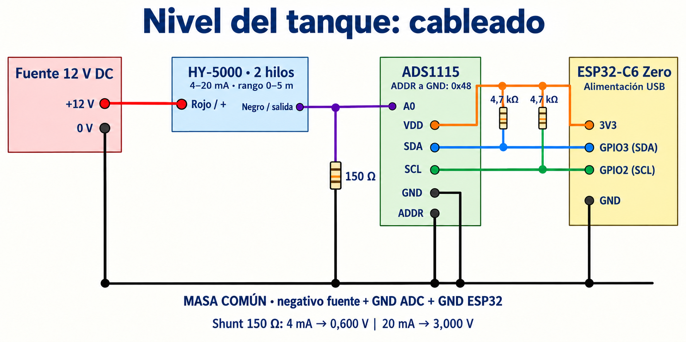
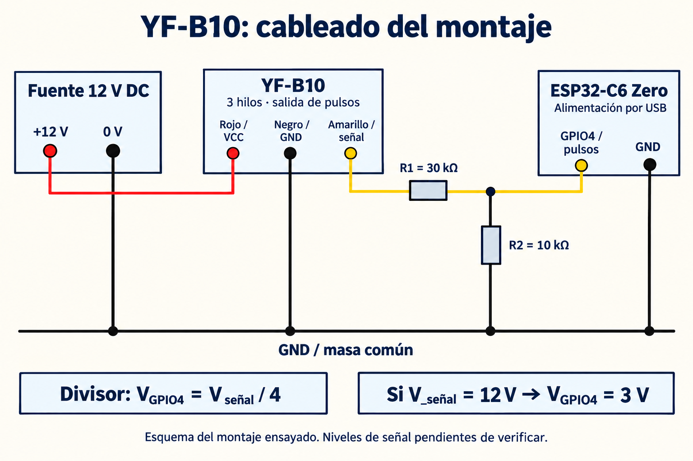

Quería medir cuánta agua queda en el tanque y llevar ese dato a Home Assistant. El firmware respondía, Zigbee funcionaba y había valores en pantalla. El problema era que el sensor, **afuera del agua**, parecía estar sumergido varios metros.

Reemplacé cables y revisé las conexiones. La solución apareció cuando conecté la masa común que faltaba. Recién entonces tuvo sentido ponerse a calibrar.

Después seguí con el caudalímetro: cambié el YF-B6 por un **YF-B10**, comprobé que detectara el paso y el cierre del agua e hice varias pruebas con 12 y 30 litros. Esa parte sigue abierta: el sensor entrega pulsos, pero los litros indicados todavía no coinciden de forma consistente con el volumen real.

<!--more-->

## 🧰 Qué estoy usando

La parte de nivel de este proyecto combina:

- Un **HY-5000**, con rango nominal de **0–5 m** y salida de **4–20 mA**, según la configuración del sensor que estoy usando.
- Una resistencia **shunt de 150 Ω**, para convertir esa corriente en una tensión.
- Un **ADS1115**, que mide la tensión sobre la resistencia.
- Un **ESP32-C6 Zero**, que adquiere las mediciones y las expone como dispositivo Zigbee.
- Una fuente externa de **12 V continuos** para el sensor; el ESP32 se alimenta por USB y entrega los 3,3 V para el ADC.

El firmware del proyecto es **0.3.0**, escrito con ESP-IDF. La integración usa un conversor externo de Zigbee2MQTT para publicar profundidad, porcentaje, corriente indicada, tensión y litros almacenados. Durante las primeras pruebas de nivel el caudalímetro estaba deshabilitado. Después incorporé el **YF-B10**, conservando el divisor y GPIO4 que tenía previstos para el YF-B6.

El ESP32-C6 trabaja como router Zigbee. Para esa parte uso el [SDK Zigbee de Espressif](https://docs.espressif.com/projects/esp-zigbee-sdk/en/latest/esp32c6/introduction.html).

## 🔌 El cableado y la masa común



*Ilustración generada con IA para este artículo. Representa las conexiones por nombre de señal; la ubicación física de los pines depende de cada módulo.*

Este es el cableado documentado para mi montaje:

| Origen | Destino |
|---|---|
| Positivo de la fuente de 12 V | Cable rojo del HY-5000 |
| Cable negro del HY-5000 | Extremo superior del shunt y A0 del ADS1115 |
| Extremo inferior del shunt | Masa común |
| Negativo de la fuente de 12 V | Masa común |
| GND del ESP32-C6 | Masa común |
| GND del ADS1115 | Masa común |
| 3V3 del ESP32-C6 | VDD del ADS1115 |
| GPIO3 del ESP32-C6 | SDA del ADS1115 |
| GPIO2 del ESP32-C6 | SCL del ADS1115 |
| ADDR del ADS1115 | Masa común; dirección I²C 0x48 |

SDA y SCL llevan pullups a **3,3 V**, típicamente de 4,7 kΩ. Antes de agregar resistencias conviene revisar cuáles trae el módulo. También corresponde desacoplar VDD con 100 nF cerca del ADC. Estas conexiones están respaldadas por el [datasheet del ADS1115](https://www.ti.com/lit/ds/symlink/ads1115.pdf).

El recorrido del lazo queda así:

```text
+12 V → HY-5000 → señal / A0 → shunt de 150 Ω → negativo de la fuente
                                                       │
                                           GND del ADS1115 y del ESP32
```

**El negro del sensor llega a la parte superior del shunt, no directamente a GND.** El ADS1115 mide ese nodo respecto de la masa común.

Cuando dije que faltaba un «neutro común», me refería al **negativo o GND del circuito de continua**. Acá no hay una conexión al neutro de la red eléctrica. Los 12 V alimentan el lazo del sensor; no van al pin 3V3 ni directamente a una entrada del ESP32 o del ADS1115. Los colores corresponden a este sensor: si tenés otra variante, verificá su identificación antes de conectarlo.

## ⚡ De corriente a profundidad

Con un shunt de 150 Ω, la relación es bastante cómoda:

```text
V = I × R
4 mA  × 150 Ω = 0,600 V
20 mA × 150 Ω = 3,000 V
```

La corriente que aparece en Zigbee2MQTT se calcula desde el voltaje del ADC:

```text
I_mA = V_ADC × 1000 / 150
```

No es una segunda medición independiente. Si el voltaje está mal, la corriente calculada también lo estará.

El firmware configura el ADS1115 para leer A0 respecto de GND, con escala de ±4,096 V y conversión single-shot a 128 muestras por segundo. La adquisición del proyecto ocurre una vez por segundo y el nivel mostrado usa un filtro IIR con `alpha=0.2`.

Con los parámetros nominales, la profundidad se obtiene así:

```text
h_m = (I_mA − 4) × 5 / (20 − 4)
```

El filtro suaviza la lectura, pero no corrige un cableado incompleto ni una escala equivocada.

## 🕵️ El sensor seco que marcaba varios metros

El 12 de octubre de 2026 hice una prueba con el sensor fuera del agua. Con el cero nominal esperaba algo cercano a 4 mA y 0,600 V. En cambio, las consultas devolvieron:

| Lectura | Corriente indicada | Tensión ADC |
|---|---:|---:|
| 1 | 16,79 mA | 2,519 V |
| 2 | 10,40 mA | 1,561 V |
| 3 | 16,60 mA | 2,491 V |
| 4 | 10,16 mA | 1,523 V |

El nivel filtrado llegó a mostrar entre **1,69 y 4,16 m**. No había una calibración que pudiera arreglar esos saltos con el sensor seco.

Lo engañoso era que el estado seguía en `ok`. En este firmware, ese estado significa que el ADC respondió y que la corriente está dentro del rango eléctrico admitido. No garantiza que la profundidad tenga sentido en el montaje real.

Después de conectar la masa común, repetí la prueba durante unos dos minutos y medio. La corriente quedó entre **3,960 y 3,963 mA**, y la tensión entre **0,5940 y 0,5944 V**. La profundidad, el porcentaje y los litros convergieron prácticamente a cero.

La mejora fue clara y consistente con la conexión que faltaba. Igual, ver un cero en pantalla no demuestra que el cero eléctrico sea perfecto: el firmware limita las alturas negativas a cero antes de filtrarlas.

## 📏 Calibrar también requiere entender dónde está el sensor

El 13 de octubre tomé los puntos dentro del agua. Hubo una confusión bastante terrenal: primero estimé unos 5 cm y después confirmé que eran **10 cm**. Más tarde bajé el sensor **30 cm adicionales**. Eso lo dejó a unos **40 cm**, no a 30 cm absolutos. El siguiente descenso de otros 30 cm lo llevó a unos **70 cm**.

Aclarar eso fue tan importante como mirar la corriente. Para repetir la prueba, la profundidad debe referirse a la distancia vertical desde la superficie hasta la **entrada de presión del sensor**, no hasta el extremo superior del cuerpo.

Estos fueron los puntos usados para el ajuste:

| Profundidad de referencia | Corriente usada | Lectura con calibración original |
|---|---:|---:|
| 0 cm, fuera del agua | 3,96125 mA | Prácticamente 0 cm |
| Aproximadamente 10 cm | 4,306667 mA | 9,5–9,7 cm |
| Aproximadamente 40 cm | 5,173000 mA | 36,6–37,0 cm |
| Aproximadamente 70 cm | 6,131334 mA | 66,3–66,7 cm |

Cada toma sumergida duró alrededor de 145 segundos, con consultas GET separadas por unos 35 segundos y observación de las publicaciones MQTT. El punto seco era del día anterior.

Las magnitudes llegan por atributos Zigbee separados. Zigbee2MQTT reúne esos valores en su estado, por lo que un mensaje puede combinar una tensión nueva con un nivel anterior. Para analizar las tomas hay que tener presente esa actualización por partes.

## 🛠️ El ajuste que quedó aplicado

Usamos un ajuste lineal por mínimos cuadrados, con igual peso para cada uno de los cuatro puntos:

```text
I_mA = b + a × h_m
b = 3,9729376 mA
a = 3,0670834 mA/m

h_m = (I_mA − b) / a
```

El firmware expresa esa recta mediante corriente mínima, corriente máxima y rango de altura. Conservé el rango nominal de **5 m** y aplicamos estos parámetros por Zigbee2MQTT:

```json
{
  "current_min_ma": 3.97294,
  "current_max_ma": 19.30835,
  "height_span_m": 5
}
```

En la prueba, los dos parámetros de corriente se escribieron de a uno y se verificaron mediante lecturas de vuelta. El valor máximo se calcula como `b + a × 5`: **no significa que haya medido el sensor a 5 m ni su corriente de fondo de escala**. Es la forma de representar la recta obtenida en el rango ensayado de 0 a 70 cm.

El shunt configurado siguió en 150 Ω y el filtro en 0,2. Los límites para el porcentaje también quedaron en 0 y 0,70 m.

Los residuos del ajuste sobre esos mismos puntos fueron de **−0,38 / +0,88 / −0,87 / +0,37 cm**. Son una medida de qué tan bien encaja la recta con los datos usados; no equivalen a una exactitud certificada de menos de un centímetro.

## 📊 Qué marcó después

Sin mover el sensor de la posición de aproximadamente 70 cm, hicimos tres comprobaciones después del ajuste:

| Comprobación | Profundidad indicada |
|---|---:|
| 1 | 70,57 cm |
| 2 | 70,48 cm |
| 3 | 70,78 cm |

En las tres el estado fue `ok`, y las lecturas de los parámetros confirmaron que el dispositivo estaba usando los valores nuevos.

Para mi tanque cilíndrico, de **1 m de diámetro interior**, el firmware también calcula los litros almacenados a partir de la profundidad. Cada centímetro equivale a unos **7,854 litros**; a 70 cm son aproximadamente **549,8 litros**. El porcentaje llega al 100 % a esa altura porque coincide con el nivel útil del flotador. El volumen acumulado del caudalímetro es otra magnitud y no debe confundirse con el agua que queda en el tanque.

## 🚰 Del YF-B6 al YF-B10

El 13 de octubre seguí con el sensor de flujo. Lo alimenté desde la fuente de **12 V continuos**, con la señal conectada al ESP32 mediante el divisor de resistencias que ya tenía armado.

La primera consulta mostró `flow_enabled=0`, estado `disabled`, caudal vacío y acumulado de 0 L. Eso explicaba por qué no aparecía una medición aunque estuviera pasando agua: el contador de pulsos todavía no estaba habilitado.

Después de confirmar el cableado, activamos el contador por Zigbee2MQTT:

```json
{"flow_enabled": 1}
```

El estado pasó a `flowing`. Las primeras tres comprobaciones indicaron **6,73 / 6,74 / 6,80 L/min**, con acumulados crecientes de **2,91 / 6,27 / 9,78 L**. Esas cifras todavía usaban los coeficientes del YF-B6; servían para comprobar actividad, pero no para aceptar la exactitud del YF-B10.

Al cerrar el agua, el caudal volvió a **0 L/min**, el estado quedó en `no_flow` y el total se mantuvo en **11,69965 L** durante unos 75 segundos. El sistema respondía al paso y al cierre del agua. `no_flow` expresa caudal convertido cero con el umbral configurado; no equivale a una medición instrumental que demuestre ausencia absoluta de pulsos.

### Cableado del sensor de flujo



*Esquema generado con IA del montaje ensayado. Los niveles reales de la señal y su adaptación al GPIO siguen pendientes de medir. Los puertos están identificados por su función, no por su posición física en una placa.*

| Conexión | Destino |
|---|---|
| Positivo de la fuente de 12 V | Alimentación del YF-B10 |
| Negativo del YF-B10 | Masa común |
| Negativo de la fuente de 12 V | Masa común |
| Salida de pulsos del YF-B10 | R1 de **30 kΩ** |
| Otro extremo de R1 | Nodo de señal y **GPIO4** del ESP32-C6 |
| Nodo de GPIO4 | R2 de **10 kΩ** hacia masa común |
| GND del ESP32-C6 | Masa común |
| Alimentación del ESP32-C6 | USB |

El esquema usa rojo para alimentación, negro para masa y amarillo para señal, una identificación que también aparece en la [documentación de una variante YF-B10 de HSH-Flo](https://www.hhflo.com/products/dc24v-water-heater-flow-sensor-1-high-precision-water-flowmeter-hall-sensor-pulse-signal-line). Para reproducirlo, verificá las funciones de los cables de tu unidad: esa ficha no identifica necesariamente el sensor concreto de mi montaje.

La señal llega a GPIO4 **a través de R1**. R2 conecta ese mismo nodo a masa. La relación ideal del divisor es:

```text
V_GPIO4 = V_señal × R2 / (R1 + R2)
        = V_señal × 10 / (30 + 10)
        = V_señal / 4
```

**Si** la salida del sensor alcanza 12 V, el divisor entrega nominalmente 3 V. Alimentar el sensor a 12 V no demuestra que su salida también alcance 12 V: ésa es una de las comprobaciones pendientes. Por ejemplo, una salida de 5 V quedaría en 1,25 V después de este divisor, por debajo del mínimo de entrada alta especificado para el C6 a 3,3 V. Los límites y umbrales están en el [datasheet del ESP32-C6](https://www.espressif.com/sites/default/files/documentation/esp32-c6_datasheet_en.pdf).

Este esquema documenta lo que usé en las pruebas. Antes de dar por válida la adaptación eléctrica faltan medir nivel alto, nivel bajo y forma de onda, considerando la fuente real y las tolerancias. Los 12 V no van directamente a GPIO4 ni al pin 3V3.

### Cómo cuento y acumulo

El firmware usa el periférico [PCNT del ESP32-C6](https://docs.espressif.com/projects/esp-idf/en/stable/esp32c6/api-reference/peripherals/pcnt.html), configurado para contar flancos ascendentes en GPIO4, con filtro de pulsos de 1 µs. En cada adquisición calcula frecuencia y caudal a partir del tiempo real transcurrido:

```text
f_Hz = Δpulsos / Δt_s
Q_L_min = max(0, (f_Hz − flow_intercept) / flow_slope)
Δvolumen_L = Q_sin_filtrar × Δt_s / 60
```

Si no hay pulsos, el código entrega cero; además aplica un umbral de **0,5 L/min**. El filtro IIR de caudal, con `alpha=0.3`, suaviza solamente el valor mostrado. El acumulado usa el caudal **antes de ese filtro**.

Los parámetros iniciales eran `flow_slope=8.1` y `flow_intercept=-3`, heredados del YF-B6. No había una calibración hidráulica aceptada para el YF-B10. En particular, el intercepto de −3 no fue medido para este sensor.

## 🔄 Una placa de reemplazo en el medio

El 14 de octubre el ESP32 anterior dejó de responder por Zigbee y tampoco conseguí que la PC lo identificara por USB. La placa tenía alimentación, pero hubo errores de conexión USB y no pude leer la consola. Terminé reemplazándola por otra ESP32-C6. **No confirmé la causa del desperfecto** ni la atribuyo al sensor de flujo.

La placa nueva recibió el firmware 0.3.0 por USB-JTAG, con verificación de escritura. Se restauraron los parámetros de profundidad y de caudal, y se comprobó que siguieran presentes después de reiniciar. También se sustituyó el dispositivo en Zigbee2MQTT y Home Assistant conservando los nombres de las 25 entidades y el acceso al historial anterior de nivel.

El acumulado de la placa nueva comenzó en 0 L. Las pruebas de calibración que siguen se hicieron sobre esa placa y sin cambiar la calibración de profundidad.

## 🪣 Las pruebas con 12 y 30 litros

El 15 de octubre preparé volúmenes conocidos para contrastar el acumulado. Antes de cada pasada verificamos comunicación, contador habilitado, caudal cero y total estable. El registro ya estaba activo cuando recibía la señal de «listo» para empezar.

No reiniciamos el total en cada prueba. Calculamos:

```text
volumen_indicado = acumulado_final − acumulado_inicial
error_% = 100 × (volumen_indicado / volumen_real − 1)
```

Al terminar, esperamos el retorno a `no_flow` y lecturas estables del acumulado en consultas separadas por más de 30 segundos. El muestreo local siguió en 1 segundo y las consultas GET se hicieron aproximadamente cada 35 segundos.

Mi idea inicial era cronometrar desde que apareciera flujo hasta que se terminara el agua. Para estas pruebas usamos principalmente la diferencia de acumulados: **los tiempos de llegada de los mensajes Zigbee/MQTT no marcan con precisión el inicio y el final hidráulicos**.

Estos fueron los cinco ensayos:

| Ensayo | Volumen real comunicado | Pendiente usada | Volumen indicado | Error |
|---|---:|---:|---:|---:|
| 1 | 12 L | 8,1 | **5,619 L** | −53,17 % |
| 2 | 12 L y algunos ml extra | 3,7930554 | **10,822 L** | Menor que −9,81 % |
| 3 | 12 L | 3,7930554 | **11,569 L** | −3,59 % |
| 4 | 30 L | 3,7249998 | **26,116 L** | −12,95 % |
| 5 | 30 L | 3,7249998 | **17,213 L** | −42,62 % |

En el segundo ensayo no medí los mililitros adicionales. El error referido a 12 L ya era de −9,81 %; al haber pasado algo más, la subestimación real era mayor. Por eso esa pasada no se usó para calcular el ajuste combinado.

### Los ajustes que probamos

En el primer ensayo, el acumulado pasó de **0,01851877 a 5,63785982 L**. La diferencia fue 5,61934105 L para los 12 L preparados. Conservando el intercepto, se aplicó una primera corrección de escala:

```text
factor = 12 / 5,61934105 = 2,13548170
pendiente_nueva = pendiente_anterior / factor
                ≈ 3,7930554
```

Ese ajuste se escribió por Zigbee2MQTT y se verificó mediante lectura de vuelta. Un solo volumen, sin pulsos crudos y tiempo activo local, no permite determinar pendiente e intercepto de forma independiente. Era una corrección provisional.

Después del tercer ensayo combinamos las dos pasadas declaradas de 12 L exactos. Con `a` como pendiente usada en cada una:

```text
a_combinada = (a_1 × volumen_indicado_1 + a_3 × volumen_indicado_3) / 24 L
            ≈ 3,7249998
```

Sobre los mismos datos usados para ajustar, esa escala reconstruía **12,219 y 11,781 L**. Esos residuos de aproximadamente ±1,83 % eran resultados del ajuste sobre sus propios datos. Las dos pruebas posteriores de 30 L fueron el contraste independiente y **no lo validaron**.

La configuración que quedó instalada es:

```json
{
  "flow_enabled": 1,
  "flow_slope": 3.7249998,
  "flow_intercept": -3,
  "flow_threshold": 0.5,
  "flow_filter_alpha": 0.3
}
```

**Estos valores siguen siendo provisionales y no son una calibración aceptada del YF-B10.** Documentan el estado actual del montaje; copiarlos a otro sensor no demuestra que vaya a medir correctamente.

### Lo que mostraron los 30 litros

En la primera pasada de 30 L, el acumulado fue de **17,20724869 a 43,32358170 L**: indicó 26,11633301 L.

En la siguiente fue de **43,32358170 a 60,53612137 L**: indicó 17,21253967 L. En ambas se mantuvieron exactamente los mismos coeficientes. Al finalizar hubo caudal cero, total estable y no se registraron errores de consulta.

No mantuve ni medí independientemente un mismo caudal hidráulico en las dos pasadas. Por eso tampoco puedo presentarlas como una prueba de repetibilidad a caudal constante. Sí muestran que el ajuste actual no dio resultados consistentes para los volúmenes y condiciones ensayados.

Durante la segunda pasada de 30 L, los valores de caudal mostrados estuvieron aproximadamente entre **3,63 y 5,42 L/min** en las consultas con flujo. Son valores calculados con la escala que estoy poniendo a prueba, no una referencia independiente.

### El acumulado también necesita una referencia nueva en cada ensayo

Entre las pruebas de 12 L observamos que el total había vuelto de 16,46028 L a un valor anterior de 5,63786 L. El firmware guarda el volumen cambiado en NVS con checkpoints de 10 minutos, así que un reinicio antes de guardar es una explicación compatible, pero no quedó confirmada la causa de ese retroceso.

Para la siguiente pasada tomamos una lectura inicial nueva y estable. Los resultados anteriores estaban registrados por separado. El total final de **60,53612 L** es un acumulado calculado con coeficientes que cambiaron durante los ensayos y con ese retroceso observado: no lo uso como volumen real total de agua consumida. Tampoco reescalamos retrospectivamente las lecturas anteriores.

## 🔎 Lo que todavía falta comprobar

La calibración quedó aplicada para el intervalo que probé. Las profundidades eran aproximadas, así que el siguiente contraste útil es colocar el sensor en **otra altura medida**, distinta de las usadas para ajustar, y comparar.

También queda pendiente verificar el valor real del shunt y la tensión con multímetro. La conservación de los parámetros de calibración después de reiniciar sí se comprobó al poner en servicio el ESP32 de reemplazo.

Con el caudalímetro, el próximo paso es **medir la señal antes y después del divisor** y contrastar el recuento de pulsos. Faltan registrar pulsos crudos y tiempo activo dentro del ESP32 para estimar pendiente e intercepto a caudales controlados. Las lecturas actuales no permiten decidir si la diferencia viene del sensor, de la adaptación eléctrica, del recuento o de la conversión usada.

La revisión del código confirmó que el filtro de visualización no modifica los litros acumulados. En las dos pasadas de 30 L tampoco hubo fallos de consulta que expliquen por sí solos los resultados. Detectar flujo y volver a cero son comprobaciones útiles, pero todavía no alcanzan para dar por buenos los litros.

El aprendizaje más útil apareció antes de tocar los números: si el sensor seco marca metros y la señal salta, primero hay que conseguir una lectura eléctrica estable. En mi montaje, eso empezó por un cable de masa que faltaba.

Con el YF-B10 quedó otra tarea: verificar el camino completo desde el pulso eléctrico hasta el volumen indicado, antes de seguir cambiando coeficientes para que coincida la última pasada.

## 📚 Referencias

- [Texas Instruments: datasheet del ADS1115](https://www.ti.com/lit/ds/symlink/ads1115.pdf), para conexiones, alimentación, entradas y configuración del ADC.
- [Espressif: introducción al ESP Zigbee SDK para ESP32-C6](https://docs.espressif.com/projects/esp-zigbee-sdk/en/latest/esp32c6/introduction.html).
- [Espressif: periférico Pulse Counter (PCNT)](https://docs.espressif.com/projects/esp-idf/en/stable/esp32c6/api-reference/peripherals/pcnt.html), referencia del contador utilizado por el firmware.
- [Espressif: datasheet del ESP32-C6](https://www.espressif.com/sites/default/files/documentation/esp32-c6_datasheet_en.pdf), especialmente los umbrales de entrada de la sección DC Characteristics.
- [HSH-Flo: documentación de una variante YF-B10](https://www.hhflo.com/products/dc24v-water-heater-flow-sensor-1-high-precision-water-flowmeter-hall-sensor-pulse-signal-line), para la identificación de los tres conductores; no se adoptó su fórmula como calibración del montaje.

Las lecturas y los ajustes de este artículo provienen de las pruebas del montaje realizadas entre el 12 y el 15 de octubre de 2026. La calibración práctica de profundidad y el diagnóstico pendiente del caudal describen este montaje; no se generalizan a todos los sensores vendidos como HY-5000 o YF-B10.
